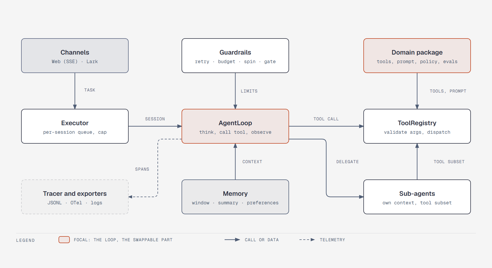
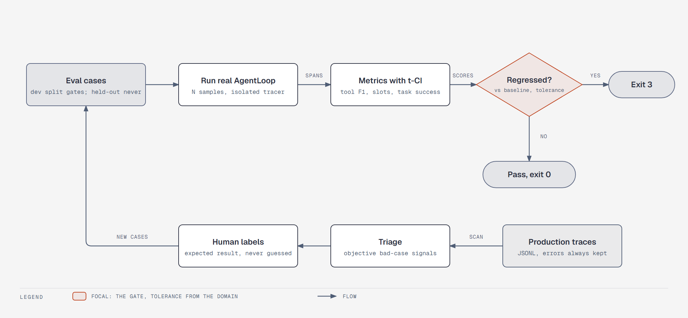

# multi-domain-agent-harness

[English](README.md) | 简体中文

这是一个自己从头写的智能体运行时。它的核心是 TAO 循环（Thought、Action、Observation，即思考、调用工具、观察结果，循环往复直到给出最终回答），另外配有保护机制（超时、重试、预算、权限检查）、分层记忆、请求追踪，以及一套回归检查：每次改动后重新运行评测，指标比基线差得太多，就判为不通过。和某个具体业务有关的东西，都放进一个可替换的**领域包**里，所以同一个运行时可以换一个业务域使用，循环本身一行都不用改。本仓库自带一个参考业务域：按摩门店的预约和咨询。

[](LICENSE)


**技术栈：** FastAPI（Web 接口，SSE 即 Server-Sent Events 服务器推送事件，用来流式输出）· LangChain（调用模型、结构化输出）· Pydantic（工具的参数定义）· SQLite 和 SQLAlchemy · OpenTelemetry（可选的追踪导出方式）· 飞书（Lark）渠道 · uv。

## 亮点

- **运行时是自己写的，不是套一层现成框架。** 循环（`harness/runtime/agent_loop.py`）、工具注册表、子智能体委派、记忆、护栏和追踪器，加起来约 2,900 行 Python。循环把模型和工具注册表作为参数传进来，所以测试时可以用一个按剧本回答的假模型来驱动它，完全不需要联网。
- **一个业务域由五样东西组成，都可以替换。** 业务域声明自己的工具、子智能体、系统提示、权限策略和评测数据，运行时从注册表里读取。守住这条规则的测试是 `tests/test_domain_loading.py`：如果业务域特有的名字混进了运行时，测试就会失败。
- **保护机制都有具体数值。** 一次模型调用 30 秒超时，最多重试 3 次，每次等待 0.5 秒、1 秒、2 秒；一次工具调用 60 秒超时；连续 3 次完全相同的工具调用，会被判定为原地重复并停止循环；一次请求默认最多循环 8 步，估算的上下文超过 token 预算时也会停止。
- **记忆压缩不会丢掉用户的约束。** 较早的对话回合，用结构化输出压缩成摘要，摘要里固定包含关键实体、已做的决定、未完成的事项和用户的约束，而不是一段自由文字。所以像“只要女技师”这样的约束，不会在一段含糊的摘要里被省略。
- **请求追踪的数据可以直接用于评测。** 每个请求是一条追踪，里面的父子片段（span）关系是显式记录的。采样导出器以整条追踪为单位决定保留还是丢弃，带错误信号的追踪一定保留；分诊工具再把这些追踪整理成候选的测试用例。
- **回归检查自带留出集。** 评测会运行真实的循环，每个用例重复运行多次，给出 95% 置信区间；当被门禁守住的指标下降超过业务域声明的容差时，以退出码 3 结束。留出集不会参与这项检查。
- **有测试保护。** 538 个单元测试和端到端测试可以离线通过（用假模型、本地 SQLite 文件和占位密钥）。运行命令见[快速开始](#快速开始)。

## 架构



| 部分 | 位置 | 作用 |
|---|---|---|
| 循环 | `harness/runtime/agent_loop.py` | 每一步询问模型，模型可能返回工具调用；循环执行这些调用，把结果交还给模型；遇到最终回答、达到 8 步、判定为原地重复或重试用尽时停止 |
| 工具 | `harness/tools/` | 一个工具声明名称、说明、参数结构和处理函数；注册表在执行处理函数前先校验参数，并用同一个 Pydantic 模型同时导出 OpenAI 和 Anthropic 两种格式的工具定义 |
| 子智能体 | `harness/subagents/` | 主智能体调用 `delegate` 工具来委派任务；每个子智能体在独立的上下文里，用自己那一部分工具运行一个小循环。例如咨询子智能体只持有 `search_knowledge`，所以它不可能创建预约 |
| 保护机制 | `harness/guardrails/` | 模型调用的超时和重试、token 预算、原地重复检测，以及一道权限检查：每次危险工具调用在执行前都要经过它 |
| 记忆 | `harness/memory/` | 最近几轮对话的窗口、较早回合的结构化滚动摘要，以及跨会话读取的长期用户偏好 |
| 可观测性 | `harness/observability/` | 一个很小的片段模型、默认的 JSON 日志导出器、可选的 OpenTelemetry 导出器、JSONL 文件导出器和按整条追踪采样的导出器 |
| 执行器 | `executor/` | 同一个会话的请求一次只处理一个，不同会话可以并行但有上限，每个会话的排队深度也有上限；Web 渠道直接流式输出，飞书渠道走队列 |
| 业务域 | `domains/` | 参考业务域：五个工具（`find_technician`、`check_availability`、`create_appointment`、`search_knowledge`、`get_user_preferences`）、三个子智能体、一份提示、一份策略和 41 条开发集用例 |

## 评测

建议先读评测这部分：完整说明在 [evals/README.md](evals/README.md)，背景知识在 [docs/agent-eval-fieldguide.md](docs/agent-eval-fieldguide.md)。



各个环节的作用：

- **走真实的调用路径，每个用例相互隔离。** 每个用例运行生产环境用的循环（主智能体、`delegate`、子智能体），各自有独立的追踪器和内存导出器，工具调用的顺序是从记录的片段里还原出来的。用例默认最多 5 个并发；41 个用例、每个重复 3 次，用并发运行约 18 分钟，串行则要约 57 分钟。
- **没有数据的指标写“不可用”，不编造数字。** 指标包括：工具调用的召回率、精确率和 F1，参数级 F1，调用序列正确率，完全匹配率，槽位完整率，任务成功率，以及由大模型裁判打分的回复质量。某个指标没有数据时，报告里写“不可用”。
- **检查哪些指标，由业务域自己声明。** 每个业务域声明自己的标签集合、哪些工具参数算槽位（槽位是用户需求里要填齐的信息项，比如预约的时间、技师、项目）、哪些指标参与回归检查，以及容差。参考业务域检查工具调用 F1 和槽位完整率，容差是 30 个百分点。这个数是按重复运行时槽位完整率实测的 95% 置信区间定的：区间是均值 ± 28.7 个百分点，± 后面的 28.7 叫半宽，等于区间宽度的一半。给一个业务域定的容差，不能拿去用在另一个业务域上。
- **开发集和留出集分开。** 41 条开发集用例（预约 20 条、查询 6 条、支付 5 条、统计 5 条、其他 5 条）用于调优和回归检查；10 条留出集用例只在明确要求时才评测，并且在代码层面就不可能写进基线文件。
- **从线上数据回到用例的流程。** `evals/triage.py` 扫描已保存的请求追踪，按客观信号找出可疑的出问题的例子（保护机制用尽、原地重复、工具失败、达到最大步数），生成一份草稿交给人来标注，标注完成后以 `source=online` 追加成新用例。期望的结果从不由程序自动填写。

### 基线（回归对照用，41 条开发集用例，每条运行 3 次）

| 指标 | 数值 | 是否参与回归检查 |
|---|---|---|
| 工具调用 F1 | 0.562 | 是 |
| 槽位完整率 | 0.877 | 是 |
| 工具调用精确率 | 0.958 | 否 |
| 工具调用召回率 | 0.556 | 否 |
| 参数级 F1 | 0.111 | 否 |
| 调用序列正确率 | 0.480 | 否 |
| 完全匹配率 | 0.455 | 否 |
| 任务成功率 | 0.236 | 否 |

这些数字是存下来的基线，以后的改动要和它比较。它们**不是**对效果好坏的结论。用例是人工手写的。任务成功率只在 24 条开发集用例上计算，这些用例标明了期望的最终工具（19 条是用 `create_appointment` 完成预约，5 条是用 `search_knowledge` 做知识检索）。那 5 条知识检索用例在这里不可能成功，因为知识库接口特意没有接入，每次调用 `search_knowledge` 都会明确返回“知识库未接入”的失败（如果返回空列表，模型会当成“没查到”，从而容易编造答案）。至于预约用例为什么没达到预期，本仓库还没有逐条分析。参与回归检查的两项指标，不依赖工具返回了什么内容。详细说明见 [evals/README.md](evals/README.md)。

## 已知的局限

- 评测数据只有 51 条手写用例（41 条开发集、10 条留出集）。它能证明这套回归检查的机制可用，但不能代表真实的用户流量。
- `services/knowledge_search.py` 里的检索接口在本仓库里没有实现。设想中由一个独立的检索服务来提供，比如 [rag-platform](https://github.com/chenyongquan2/rag-platform)，目前还没有写适配代码。
- 回复质量的大模型裁判没有用人工标注校准过，所以只观察它的结果，不参与回归检查。
- 只有一个参考业务域。业务域的机制、加载规则和测试都在，但没有附带第二个业务域。
- `docs/` 下的文档大部分是中文。

## 快速开始

需要 [uv](https://docs.astral.sh/uv/) 和 Python 3.10 到 3.12。

```bash
uv sync
cp .env.example .env     # Windows PowerShell：Copy-Item .env.example .env
mkdir data               # SQLite 文件放在这里
uv run pytest            # 离线运行：用假模型，不需要 API 密钥
```

要运行服务，需要一个兼容 OpenAI 接口的对话模型和一个向量模型，把密钥填进 `.env`，然后执行：

```bash
uv run uvicorn app:app --host 127.0.0.1 --port 8001 --workers 1
```

请只用一个 worker 进程：`create_appointment` 目前还没有幂等键。要用真实模型运行评测：

```bash
uv run python evals/run_evals.py --samples 3 --gate
```

完整步骤和常见报错见 [RUNNING.md](RUNNING.md)，接入飞书渠道的方法见 [docs/feishu-app-setup.md](docs/feishu-app-setup.md)。

## 仓库结构

| 路径 | 内容 |
|---|---|
| `harness/` | 与业务域无关的运行时：循环、工具、子智能体、保护机制、记忆、可观测性 |
| `domains/` | 业务域包和加载器；`appointment/` 是参考业务域 |
| `evals/` | 评测运行器、指标、裁判、分诊；业务域自己的数据放在 `domains/<名字>/evals/` 下 |
| `executor/`、`channels/`、`api/`、`web/` | 任务执行、飞书渠道、HTTP 接口和网页 |
| `services/`、`db/`、`config/` | 业务服务、数据模型和仓储、配置 |
| `tests/` | 538 个离线测试 |
| `docs/` | 设计笔记、评测教材、配置指南 |

## 许可证

[MIT](LICENSE)。
